# Deliverable 4 — Data model, field dictionary and entity relationships

Companion artefact: [`DATA_DICTIONARY_AS_IS.csv`](DATA_DICTIONARY_AS_IS.csv) — 978
rows, one per declared field, extracted by `scripts/audit/fields.py`.

---

## 1. The AS-IS field dictionary

**[FACT]** 978 fields across 80 model classes (62 new concrete, 22
abstract/transient, plus extensions of standard models).

| Type | Count | | Governance attribute | Count |
|---|---|---|---|---|
| Char | 231 | | `required=True` | 242 |
| Many2one | 181 | | `tracking=True` (chatter audit) | 139 |
| Selection | 126 | | `index=True` | 115 |
| Integer | 114 | | `groups=` (field-level security) | 23 |
| Boolean | 84 | | `company_dependent=True` | **0** |
| Text | 79 | | | |
| Date / Datetime | 72 | | | |
| Monetary | 34 | | with explicit `currency_field` | **34 / 34** |
| One2many | 20 | | | |
| Float | 19 | | money-shaped names | 1 |
| Html / Binary / Many2many | 18 | | | |

The CSV carries the blueprint §7.4 governance columns. Four are deliberately
**empty**: `security_class`, `source_of_truth`, `audit_policy`, `test_id`. They
cannot be derived from code — they are business decisions. Filling them is
`BACKLOG.md` `DOC-001` and it is a data-governance workshop, not an engineering task.

---

## 2. Integration seams — where custom models touch Odoo standard

**[FACT]** Many2one/One2many targets pointing at standard Odoo models, counted
across all 978 fields:

| Standard model | References | What this tells us |
|---|---|---|
| `res.company` | 24 | Company scoping is modelled consistently |
| `res.users` | 18 | Ownership/assignment modelled |
| `res.currency` | 10 | Pairs with the 34 Monetary fields — correct |
| `res.partner` | 8 | Party master used natively, not duplicated |
| `crm.lead` | 6 | The growth layer integrates properly with standard CRM |
| `project.project` | 4 | `c2p_project_tracker` |
| `project.task` | 3 | `c2p_project_tracker` (milestones are tasks) |
| `sale.order` | **2** | `media.plan.sale_order_id`, `project.project.c2p_sale_order_id` |
| `purchase.order` | **2** | `media.plan.purchase_order_ids`, marketplace RFQ wizard |
| `account.move` | **0** | — |
| `account.move.line` | **0** | — |
| `account.payment` | **0** | — |
| `stock.picking` | **0** | — |
| `stock.move` | **0** | — |

### 2.1 This table is the audit's hardest single finding

**[FACT] Not one of the 978 declared fields references an invoice, an invoice
line, a payment, a picking or a stock move.**

Blueprint §4.2 requires that "source document → fulfillment → invoice → payment →
journal links [be] traceable at line level", and §7.3 specifies the M:N allocation
tables that make it so. In this repository:

- `media.plan` knows its `sale_order_id` and its `purchase_order_ids`, and holds
  `media_cost`, `commission_amount`, `net_revenue`. **It cannot tell you whether
  any of that was invoiced, or paid.** The margin figures are planning numbers
  with no tie to the ledger.
- `project.project.c2p_sale_order_id` links a portfolio project to its order, and
  `contract_value` / `amount_received` are entered **by hand** rather than derived
  from posted invoices and payments. A commercial dashboard built on hand-entered
  receipts is a dashboard that will disagree with the accounts.
- No module can answer "show me the journal entries behind this number", which is
  precisely what blueprint §11.1 forbids ("avoid magic totals").

**[DESIGN]** The fix is not more fields — it is to stop storing derived money and
read it from `account.move` instead. For `c2p_project_tracker` specifically:
`amount_received` should become a computed field over reconciled payments on
invoices linked to `c2p_sale_order_id`, with the hand-entered value retained only
as an override that is visibly flagged as such. That is `BACKLOG.md` `FIN-002`.

---

## 3. AS-IS entity relationship model

Only edges that exist in source. Standard Odoo models are shown shaded.

```mermaid
erDiagram
  res_company ||--o{ mumtaz_tenant : "scopes"
  res_partner ||--o{ mumtaz_sme_profile : "is"
  mumtaz_brand ||--o{ mumtaz_tenant : "brands"
  mumtaz_tenant ||--o{ mumtaz_subscription : "subscribes"
  mumtaz_plan  ||--o{ mumtaz_subscription : "priced by"
  mumtaz_plan  ||--o{ mumtaz_plan_feature : "grants"
  mumtaz_feature ||--o{ mumtaz_plan_feature : "in"
  mumtaz_feature ||--o{ mumtaz_tenant_feature : "enabled for"
  mumtaz_subscription ||--o{ mumtaz_subscription_billing_record : "bills"
  mumtaz_subscription ||--o{ mumtaz_subscription_lifecycle_log : "logs"
  mumtaz_subscription ||--o{ mumtaz_usage_metric : "metered by"
  mumtaz_tenant ||--o{ mumtaz_cfo_workspace : "owns"
  mumtaz_cfo_workspace ||--o{ mumtaz_cfo_data_source : "ingests from"
  mumtaz_cfo_data_source ||--o{ mumtaz_cfo_upload_batch : "batches"
  mumtaz_cfo_category ||--o{ mumtaz_cfo_mapping_profile : "maps"
  crm_lead ||--o{ lead_scraper_record : "sourced as"
  lead_scraper_source ||--o{ lead_scraper_job : "runs"
  lead_scraper_job ||--o{ lead_scraper_record : "produces"
  crm_lead ||--o{ lead_nurture_log : "nurtured in"
  lead_nurture_campaign ||--o{ lead_nurture_step : "sequences"
  sale_order ||--o{ media_plan : "ordered as"
  purchase_order }o--o{ media_plan : "bought via"
  media_outlet ||--o{ media_rate_card : "rates"
  media_rate_card ||--o{ media_rate_card_line : "lines"
  project_project ||--o{ project_task : "milestones"
  project_project ||--o{ c2p_raid_item : "risks"
  project_project ||--o{ c2p_change_request : "changes"
  project_project ||--o{ c2p_milestone_history : "baselines"
  sale_order ||--o| project_project : "c2p_sale_order_id"
  project_project ||--o| project_project : "c2p_counterpart_id (cross-company)"
  account_move }o..o{ GAP : "NO LINK EXISTS"
  account_payment }o..o{ GAP : "NO LINK EXISTS"
  stock_picking }o..o{ GAP : "NO LINK EXISTS"
```

The three `GAP` nodes are not decoration. They are the missing half of the ERP.

---

## 4. Universal entity contract compliance (blueprint §7.1)

Scored against the 62 concrete models.

| §7.1 field / concept | Status |
|---|---|
| `id` | **Met** — Odoo ORM |
| `company_id` | **Mostly met** — 24 references; not on every transactional model |
| `tenant_id` | **Partially met** — present but competing with `mumtaz.tenant` M2O and DB-per-tenant (DEC-002) |
| `branch_id`, `department_id` | **Missing entirely** — no branch or department model exists |
| `code` / `sequence` | **Partial** — 1 `ir.sequence` reference |
| `status` / `substatus` | **Met** — 126 Selection fields; state machines exist |
| `document_date`, `effective_date` | **Partial** — 72 date fields, no effective-dating discipline |
| `created_at/by`, `updated_at/by` | **Met** — ORM `create_date`/`create_uid` |
| `owner_id`, `assigned_to_id` | **Met** — 18 `res.users` references |
| `version` / revision | **Missing** — no optimistic-locking or revision field anywhere |
| `currency_id`, `exchange_rate_id` | **Partial** — 10 currency refs, **no rate-context storage** (§4.2 requires source rate + timestamp) |
| `source_system`, `source_record_id` | **Missing entirely** — blocks all migration (§14.1 item 3) |
| `origin_ref`, `external_ref` | **Missing** |
| `approval_state`, `approved_by/at` | **Missing entirely** — no approval model in the whole repository |
| `active` / `archived_at` | **Met** — Odoo `active` |
| `notes`, `tags`, `attachments` | **Met** — `mail` in 15 modules |
| `analytic_distribution` | **Missing** — no analytic dimension used |

**Five absences compound into one problem:** no `version`, no `approval_state`, no
`source_record_id`, no `branch_id`, no `analytic_distribution`. Together they mean
the data model cannot express *concurrency control*, *authorisation*, *migration
identity*, *organisational routing* or *cost attribution*. Each is cheap to add
now and expensive to retrofit once there is production data in 62 models.

**[DESIGN]** Add them as a single reusable Odoo abstract mixin rather than
62 times over — `BACKLOG.md` `ARCH-001`. One `models.AbstractModel` carrying
`source_system` / `source_record_id` / `version` / `approval_state` /
`approved_by` / `approved_at`, inherited by every transactional model, gives the
blueprint's §7.1 contract in one reviewable change.
