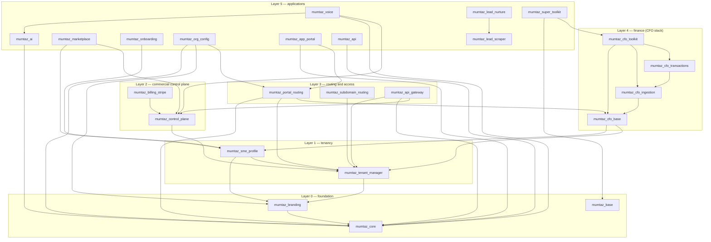
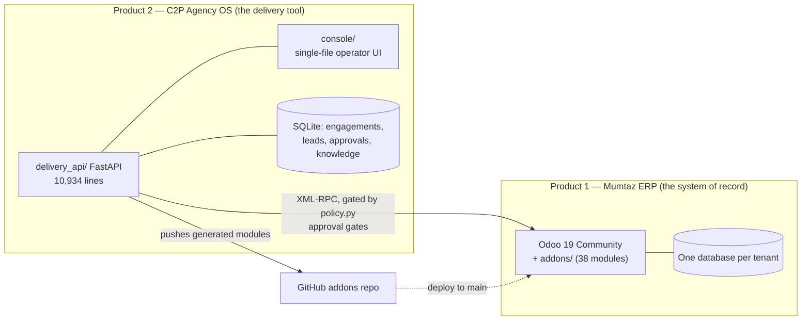

# Deliverable 3 — Module dependency and integration architecture

Generated from the 38 `__manifest__.py` files at commit `1ea980a`. Every edge below
is a real `depends` entry, not a conceptual relationship.

---

## 1. Standard Odoo apps this solution sits on

**[FACT]** 13 standard modules are depended upon:

| Standard module | Modules depending on it | Role in this solution |
|---|---|---|
| `mail` | 15 | Chatter, activities, tracking — the audit substrate |
| `base` | 11 | — |
| `web` | 8 | OWL assets, backend client |
| `account` | 7 | **The financial system of record** |
| `portal` | 4 | External user access |
| `website` | 4 | Public pages |
| `crm` | 4 | Lead/opportunity system of record |
| `purchase` | 3 | P2P |
| `stock` | 2 | Inventory |
| `sale` | 2 | L2C |
| `contacts` | 1 | Party master |
| `sale_management` | 1 | Quotations |
| `project` | 1 | `c2p_project_tracker` only |

**[FACT] No Enterprise module is depended upon anywhere.** The Community
constraint holds across the whole repository.

---

## 2. Own-module dependency graph

**[FACT] Acyclic** (verified by three-colour DFS over the 36 own→own edges).
Blueprint §5 prohibits cycles; the prohibition is satisfied.

Standalone (no own-module dependency): `c2p_project_tracker`, `mumtaz_ceo_dashboard`,
`mumtaz_crm_starter`, `mumtaz_customer_portal`, `mumtaz_einvoicing`,
`mumtaz_financial_reports`, `mumtaz_media_buying`, `mumtaz_organization`,
`mumtaz_portal`, `mumtaz_sso`, `mumtaz_theme`, `mumtaz_vendor_portal`,
`mumtaz_website`, `mumtaz_zaki`.

### 2.1 Dependency depth

**[FACT]** Longest own-module chains:

| Depth | Module | Chain |
|---|---|---|
| 9 | `mumtaz_super_toolkit` | → `cfo_toolkit` → `cfo_transactions` → `cfo_ingestion` → `cfo_base` → `sme_profile` → `tenant_manager` → `branding` → `core` |
| 8 | `mumtaz_cfo_toolkit` | as above minus one |
| 7 | `mumtaz_app_portal`, `mumtaz_org_config`, `mumtaz_cfo_transactions` | via `portal_routing` → `cfo_base` → … |

**[DESIGN] This is the architecture's main structural weakness.** `mumtaz_base`
and `mumtaz_super_toolkit` are 50 and 19 lines respectively — near-empty modules
sitting at the top of a nine-deep chain. Meanwhile `mumtaz_portal_routing`
(Layer 3, routing) depends on `mumtaz_cfo_base` (Layer 4, finance), which is a
**layering inversion**: routing should not need the finance layer to install.

Recommended remediation (not yet approved — see `BACKLOG.md` `ARCH-002`): invert
that edge by having `cfo_base` register its routes with `portal_routing` rather
than `portal_routing` importing `cfo_base`.

### 2.2 Load-bearing modules

**[FACT]** Most-depended-upon own modules: `mumtaz_core` (8), `mumtaz_tenant_manager`
(6), `mumtaz_control_plane` (4), `mumtaz_branding` (3), `mumtaz_cfo_base` (3),
`mumtaz_sme_profile` (3). A breaking change in `mumtaz_core` or
`mumtaz_tenant_manager` reaches most of the platform, and **neither has a single
test**. These two modules are where test coverage must start.

---

## 3. Integration architecture

**[FACT]** Integrations present in source, with their blueprint §13 registration
status. §13 requires *owner, source of truth, direction, trigger, auth, mapping,
identifiers, idempotency, retries, failure queue, monitoring, test harness and
recovery* for each. **None is registered.**

| Integration | Module | Direction | §13 registered? |
|---|---|---|---|
| Stripe billing | `mumtaz_billing_stripe` (799 lines, 3 models) | Out + webhook in | **No** |
| Anthropic / OpenAI LLM | `mumtaz_ai` provider abstraction | Out | **No** |
| ElevenLabs voice | `mumtaz_voice`, `mumtaz_core.settings` | Out | **No** |
| UAE Peppol e-invoicing | `mumtaz_einvoicing` | Out | **No** |
| KSA ZATCA Phase 2 | `mumtaz_einvoicing` (cert/CSR/CSID fields) | Out | **No** |
| Pakistan FBR digital invoicing | `mumtaz_einvoicing` | Out | **No** |
| Public API (inbound) | `mumtaz_api_gateway` (API key + usage log) | In | **No** |
| GitHub module push | `c2p-delivery-system/delivery_api/github.py` | Out | **No** |
| Odoo XML-RPC bridge | `c2p-delivery-system/delivery_api/odoo.py` | Out | **No** |
| Lead scraping sources | `mumtaz_lead_scraper` (2,626 lines) | In | **No** |
| `zaki-server` platform API | `platform/zaki/backend` | Both | **No** |

**[FACT] No idempotency infrastructure exists anywhere**: no outbox table, no
`idempotency_key` field among the 978 declared fields, no dead-letter model, no
`source_system` / `source_record_id` pair. Blueprint §4.4 and §13 both require
them, and §13 explicitly forbids claiming exactly-once delivery without
qualifying infrastructure.

The highest-risk consequence is concrete: **a replayed Stripe webhook can
double-apply a subscription state change, and a retried e-invoice submission can
double-submit to a tax authority.** Neither path has a duplicate guard in source.
This is `BACKLOG.md` `INT-001`, and it is the first integration work that should
happen.

---

## 4. The two-product boundary

**[DESIGN]** The repository holds two products that must not be allowed to merge:

**The contract between them is the thing to protect.** `delivery_api/policy.py`
already gates `config_apply`, `code_deploy` and `proposal_send` behind approvals,
which is the right instinct and matches blueprint §12's "act with approval" class.
What is missing is that the gate is **not** expressed as a §13 integration
contract, so there is no documented authority boundary, no dry-run, and no audit
trail on the Odoo side showing which changes arrived from the Agency OS versus a
human.

**[DECISION DEC-003]** Does the Agency OS retain write access to client
production databases at all? A tool that can write to a client's ledger is a tool
that can destroy a client relationship. The safer design — Agency OS proposes,
a human applies — costs little and removes the whole risk class.
