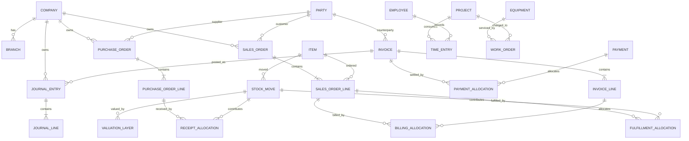

# Core ERP Entity Relationship Reference

Illustrative, framework-independent relationships. `BillingAllocation`, `FulfillmentAllocation`, and `PaymentAllocation` are explicit linkage concepts; in Odoo these may already be represented by native relationships and should **not** be duplicated blindly. Physical schema must follow the approved platform and documented mapping.

## Referential rules

- Validate legal company and tenant scope for every link.
- All parent-to-child document line relations should be indexed for drill-down and reconciliation.
- Prevent deletion of posted history and disallow orphaned allocations.
- Do not assume a document number is unique across entities, companies or instances.
- Use independent document status and fulfillment/billing status; don't collapse them into one boolean.
- Reconcile quantities, amounts, taxes, currencies and sign conventions at integration boundaries.
