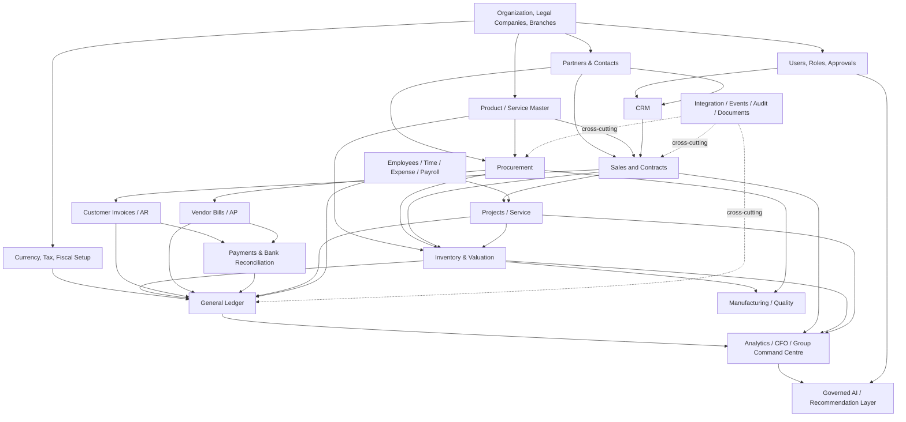

# Suggested ERP Module Dependency Map

This diagram is a **conceptual domain dependency map**, not an auto-install list. Adjust after checking the target platform and client scope. Keep optional modules independently installable.

## Implementation sequencing

- Foundation first: organization, identity, tax/currency, partners, items, audit, documents and integration contract design.
- Ensure a minimal GL/financial control layer exists before going live with invoice posting or stock valuation requiring accounting.
- Implement quote-to-cash and procure-to-pay as **vertical slices** with reconciled documents, not as a one-time big bang.
- Build industry modules after their operational and finance dependencies pass verification.
- Add BI and AI after data definitions, role boundaries and source-of-truth reports are proven.

## Dependency anti-patterns

- An optional AI module must not own or post the finance ledger.
- A warehouse UI must not manipulate receivable balances.
- Sales and procurement must share defined catalog/party modules instead of maintaining duplicate masters.
- Do not place two-way technical dependencies between modules; use a declared adapter/integration module and contract where necessary.
- Do not mix shared departmental allocation with legal intercompany bookkeeping.
