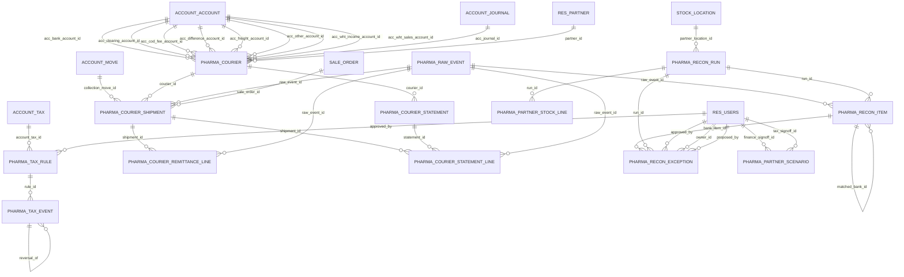

# 04a. Data model and entity relationships (as built, plus the mapping to the blueprint)

Field-level detail: [`DATA_DICTIONARY_AS_BUILT.csv`](DATA_DICTIONARY_AS_BUILT.csv): **1,579 field rows** extracted by script from 124 `_name` models and 55 extension classes across all 63 add-ons on 2026-11-20. Columns follow the blueprint template. The script fills what the source states (name, label, type, precision, required, default, relation, compute/related, groups, tracking, index); the columns **`unique_scope`, `validation_rule`, `editable_states`, `company_scope`, `security_class`, `allowed_roles`, `source_of_truth`, `API_contract`, `UI_screen`, `report_usage`, `test_id`** are intentionally empty: they are business facts a script must not invent. They are completed per module spec (backlog DOC-001), starting with pharma. Rows are auto-extracted from `fields.X(...)` declarations only; fields created any other way would be missing `[A]`.

## 1. Pharma tenant: entity catalogue (verified from code)

| Model | Add-on | Purpose | Fields | State machine |
| --- | --- | --- | ---: | --- |
| `pharma.raw.event` | pharma_core | Pharma Raw Source Event | 7 | archived → posted → invalid → conflict |
| `pharma.courier` | pharma_courier_cod | Courier | 8 | - |
| `pharma.courier.remittance` | pharma_courier_cod | Courier COD Remittance | 20 | draft → posted → cancel |
| `pharma.courier.remittance.line` | pharma_courier_cod | Courier COD Remittance Line | 15 | - |
| `pharma.courier.shipment` | pharma_courier_cod | Courier Shipment | 28 | booked → in_transit → delivered → returned → cancelled |
| `pharma.courier.statement` | pharma_courier_cod | Courier Statement Upload | 14 | draft → validated → built → cancel |
| `pharma.courier.statement.line` | pharma_courier_cod | Courier Statement Row | 24 | pending → valid → error → built |
| `pharma.courier.remittance` | pharma_courier_cod_accounting |  | 6 | - |
| `pharma.cod.entry.reversal` | pharma_courier_cod_accounting | COD entry reversal (shared behaviour) | 0 | - |
| `pharma.courier.entry.reverse` | pharma_courier_cod_accounting | Reverse a COD journal entry | 4 | - |
| `pharma.courier.shipment` | pharma_courier_cod_accounting |  | 6 | - |
| `pharma.courier.demo.seed` | pharma_courier_cod_demo | Courier COD DEMO data seeder (fictional, idempotent) | 0 | - |
| `pharma.demo.seed` | pharma_demo_data | Pharma DEMO data seeder (fictional, idempotent) | 0 | - |
| `pharma.tax.event` | pharma_pk_tax_core | Pharma Tax Event | 15 | - |
| `pharma.tax.rule` | pharma_pk_tax_core | Pharma Tax Rule (effective-dated, approved-only) | 13 | draft → approved → superseded |
| `pharma.partner.scenario` | pharma_reconciliation_hub | Distribution Partner Scenario Approval | 6 | - |
| `pharma.partner.stock.line` | pharma_reconciliation_hub | Distribution Partner Stock Roll-forward | 15 | - |
| `pharma.recon.run` | pharma_reconciliation_hub | Reconciliation Run | 15 | imported → validated → matched → partial → pending → disputed → approved → closed |
| `pharma.recon.item` | pharma_reconciliation_hub | Reconciliation Item | 11 | pending → matched → exception |
| `pharma.recon.exception` | pharma_reconciliation_hub | Reconciliation Exception | 11 | open → investigating → pending_approval → closed |
| `pharma.website.demo.seed` | pharma_website_demo | Pharma DEMO website seeder (fictional, idempotent) | 0 | - |

## 2. Pharma ER diagram (generated from `Many2one` fields; standard Odoo models included where referenced)

## 3. Blueprint entity → Odoo native model (so nothing is duplicated)

| Blueprint entity | Odoo 19 model | Custom extension here | Note |
| --- | --- | --- | --- |
| Company, Branch | `res.company`; branch via analytic account or child company `[D-003]` | none | Custom models do not yet carry `company_id` (gap G-1) |
| Party / customer / vendor | `res.partner` | none | Receivable account read from the partner property |
| Item / SKU | `product.template` / `product.product` | classification fields on `product.template` (`pharma_tax_status`, `pharma_tax_class`, `pharma_hs_code`, `pharma_drap_ref`, evidence ref, proposed-by / approved-by), added by `pharma_pk_tax_core` | Tax class is a control attribute, not a second price |
| Tax | `account.tax` | `pharma.tax.rule` (approved, effective-dated) with optional `account_tax_id` and equality check | One source of rates: the Odoo tax; the rule *governs* it |
| Sales order / line | `sale.order` / `.line` | tax gate on confirm | Order line ↔ delivery ↔ invoice links are Odoo's native many-to-many |
| Stock move / valuation | `stock.move`, `stock.valuation.layer` | `pharma_partner_stock` reads done moves | No custom stock ledger |
| Invoice / payment / allocation | `account.move`, `account.payment`, partial reconciliation | none; collection credit relies on native receivable reconciliation | Gap G-4 |
| Journal entry / line | `account.move` / `.line` | `pharma_cod_kind` tag on COD entries (written, not run) | Entries are created `draft` only |
| Courier parcel | **no native equivalent** | `pharma.courier.shipment` | Justified gap (see 06) |
| Remittance / settlement batch | **no native equivalent** | `pharma.courier.remittance` + hub run | Justified gap |
| Reconciliation run / exception | partly native bank reconciliation | `pharma.recon.run/item/exception` | Multi-source, maker-checker; coexists with native reconcile |
| Audit event | chatter (`mail.message`), `tracking=True` | immutable `pharma.raw.event` for source data | A dedicated audit-event view is proposed, not built |
| Approval | none in Community | maker-checker implemented per model | Generic mixin proposed `[D-007]` |

## 4. Conformance to the blueprint's universal entity contract (§7.1)

| Contract field | Pharma status |
| --- | --- |
| `id`, `code/sequence`, `status`, `created_*`, `updated_*` | Provided by the ORM and `ir.sequence`; states are explicit Selection fields |
| `company_id`, `branch_id` | **Missing** on all 18 models |
| `currency_id`, rate context | **Missing**; money is `Float(16,2)` |
| `source_system/source_record_id` | Present for ingested rows (`pharma.raw.event.source`, `event_id`); not on parcels, remittances |
| `version` (concurrency) | Not implemented; ORM write-time semantics only |
| `approval_state/by/at` | Present on tax rules, exceptions (maker-checker); not generic |
| `active/archived_at` | Standard `active` where used |
| data classification, owner, retention | Not recorded |
| `analytic_distribution` | Not used on COD entries (`[P]` add to settlement/collection lines when projects/cost centres are scoped) |

## 5. Identity and linkage rules (adopted for all new work `[P]`)

1. Business identity is `(source, external id)`, never a display name or document number (already true for raw events and courier parcels: unique `(courier, tracking)`).
2. Cross-record links declare cardinality and delete behaviour: documents are linked with `ondelete="set null"` or `restrict`, **never cascade over posted history** (the COD entry links use `set null` so deleting a draft frees the record; posted entries cannot be deleted by Odoo).
3. Status and fulfilment/billing/settlement are independent fields (parcel `state` vs `cod_state` vs computed `flow_stage`), never one boolean.
