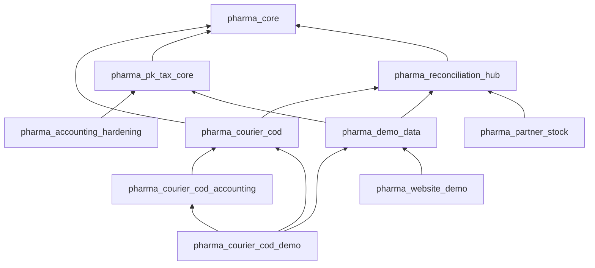
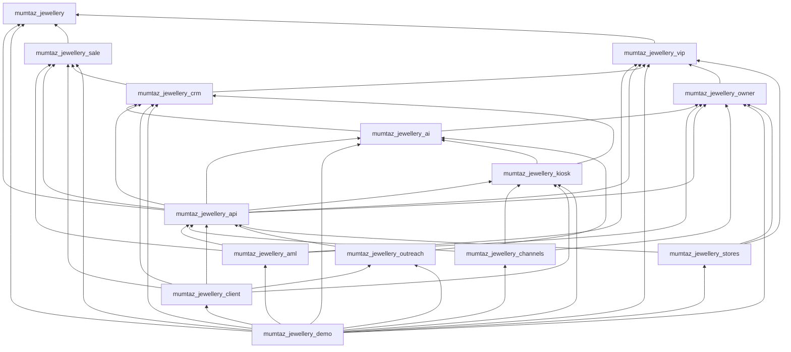
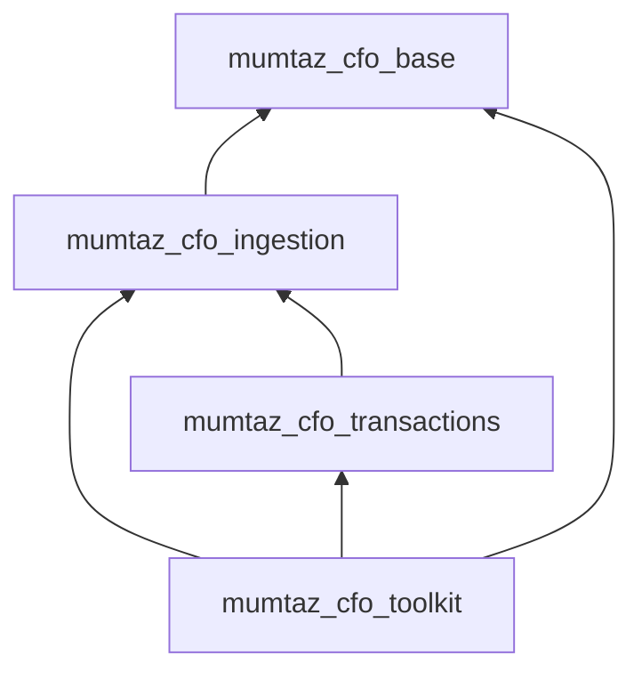
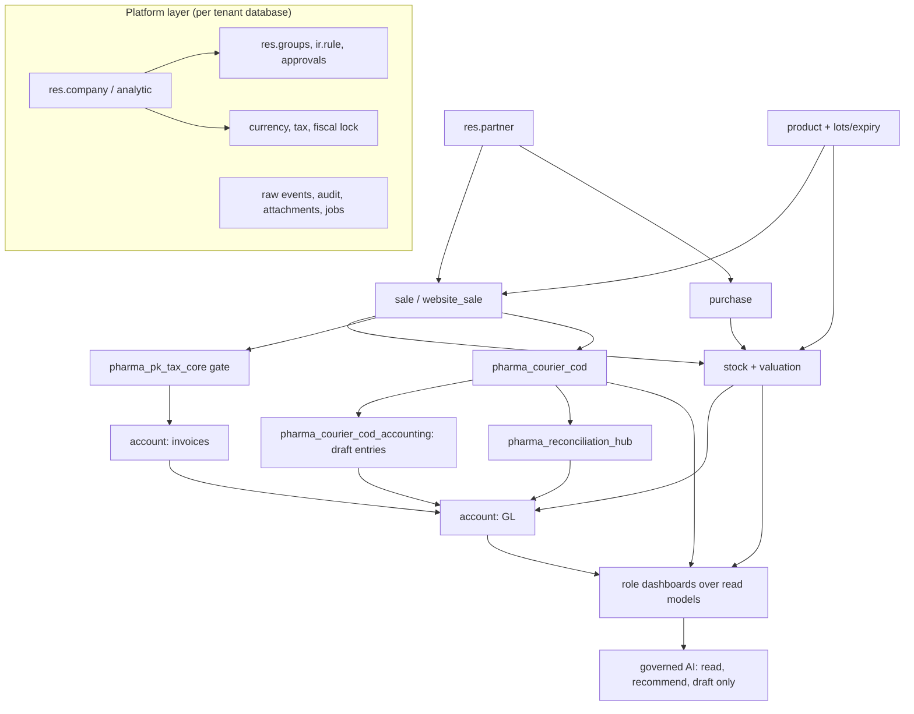

# 03. Module dependency and integration architecture

Generated from the 63 `__manifest__.py` files on 2026-11-20 (`[V]` unless marked). Regenerate, do not hand-edit the graphs.

## 1. As-built facts

| Check (blueprint §5 and the dependency anti-patterns) | Result |
| --- | --- |
| Custom add-ons | 63: c2p 2, cfo 4, jewellery 14, pharma 10, platform 33 |
| Module-level dependency cycles | **0** |
| Maximum dependency depth | 8 (deepest: mumtaz_jewellery_demo, mumtaz_super_toolkit, mumtaz_cfo_toolkit) |
| Cross-family edges (custom to custom) | cfo to platform: 2, platform to cfo: 2 |
| Family-level two-way coupling | **Yes, platform and CFO** reference each other: `mumtaz_portal_routing` and `mumtaz_super_toolkit` depend on CFO modules, while CFO modules depend on `mumtaz_tenant_manager`/`mumtaz_sme_profile`. No cycle exists, but it breaks the blueprint's "no two-way dependency between modules" intent at family level. `[P]` move the shared contract into a small adapter module (backlog ARC-001). |
| Optional modules independently installable | pharma: yes (demo and website modules sit on top, never below). `[A]` not verified for the others |
| AI/BI/finance-tool modules owning ledger state | **None.** Checked 12 add-ons (`mumtaz_ai`, `_voice`, `_jewellery_ai`, `c2p_command_center`, `mumtaz_ceo_dashboard`, `_financial_reports`, `_cfo_*`, `_zaki`, `_billing_stripe`): zero `create`/`write`/`post` on `account.move`; `mumtaz_ai` only runs `search_count`/`read_group`. The single posting hook is `mumtaz_einvoicing` extending `account.move.action_post` through `super()` (`mumtaz_einvoice.py:435`), which preserves native posting. The COD draft entries (pharma) are the only module-created entries, always `draft` |

## 2. Pharma tenant, module level

Layers: L0 `pharma_core` (roles, immutable raw events) · L1 `pharma_pk_tax_core`, `pharma_reconciliation_hub` · L2 `pharma_courier_cod`, `pharma_partner_stock`, `pharma_demo_data`, `pharma_accounting_hardening` · L3 `pharma_courier_cod_accounting`, `pharma_website_demo` · L4 `pharma_courier_cod_demo`.
Rules the layering already obeys: demo and website modules depend downward only; accounting-specific behaviour lives in its own add-on so a tenant without Accounting keeps the lean ledger; `pharma_accounting_hardening` sits above the third-party kit and our tax core.

## 3. Jewellery, CFO and platform (module level)

Platform and control-plane add-ons (33) hang off `mumtaz_core`, `mumtaz_tenant_manager`, `mumtaz_control_plane` and `mumtaz_sme_profile`; see `docs/ARCHITECTURE.md` §3 for their roles. `mumtaz_control_plane` is documented as the *source of truth for which apps a tenant may use*.

## 4. To-be domain map `[P]` (blueprint §4.1, mapped to Odoo)

Boundaries `[P]`: custom modules **read** foreign state through documented fields and **write** only through the owning model's public actions (for example `action_confirm`, `_post`); the tax gate and COD accounting already follow this. Any new module that needs two-way data uses an adapter add-on and a written contract.

## 5. Integration register (as-built, to be turned into contracts)

| ID | Integration | Direction | Source of truth | Contract today | Gap |
| --- | --- | --- | --- | --- | --- |
| INT-01 | Courier delivery report and remittance slip files | in | Courier for parcel status; us for slips posted | Odoo import screen onto staging lines; validated; every row archived as `pharma.raw.event` with `courier:{code}:{statement}:{reference}` | Idempotent by event id; no scheduled/API fetch (no courier credentials in repo, correct). Needs written contract template |
| INT-02 | Sales channels (storefront, Shopify-style orders) to tax events | in | Channel for order facts; us for tax decision | `pharma.raw.event.ingest(source, event_id, payload)` immutable, duplicate-safe, conflict state | Contract per channel not written |
| INT-03 | Bank credits to remittances | in | Bank | **None** (hub matches loaded items only) | Statement import missing (PHA-FIN-002) |
| INT-04 | Platform API (`zaki-server`) to Odoo | both | Odoo for auth and tenant data | XML-RPC with per-tenant DB scoping, JWT | Documented in `docs/ARCHITECTURE.md`; contract tests absent (2 tests in platform) |
| INT-05 | Marketplace to ERP (products, listings) | both | Odoo | `docs/ARCHITECTURE.md` §5 | Not verified here |
| INT-06 | E-invoicing gateway (ZATCA/other) | out | Tax authority | `mumtaz_einvoicing` (4 models); `security/h1-h2-zaki-server-side-and-einvoice-csrf` branch exists | Scope for pharma/PK unknown `[D-006]`; no contract tests |
| INT-07 | Third-party accounting kit | in-process | Kit for its own reports | Pinned commit `fdeea97d`, source outside repo; support call-home disabled by `pharma_accounting_hardening` | Vendor dependency (ADR-004); a regression once removed the hardening unnoticed, now surfaced by `stage.sh verify` |

Every integration above needs one filled `templates/INTEGRATION_CONTRACT_TEMPLATE.md` before it counts as governed (backlog ARC-002).
