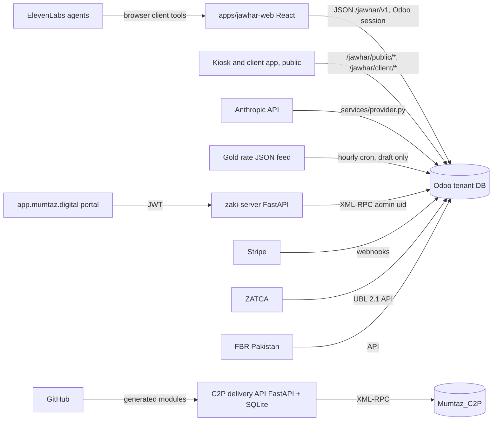

# 3. Module dependency and integration architecture

## 3.1 AS-IS dependency graph [VERIFIED from `__manifest__.py`]

```mermaid
flowchart TD
  subgraph odoo["Odoo 19 Community"]
    base --> mail --> crm
    base --> product --> stock
    product --> sale[sale_management]
    stock --> account
    sale --> account
    base --> purchase --> account
    base --> project
    base --> portal --> website
  end

  subgraph platform["Mumtaz platform (37 modules)"]
    mumtaz_core --> mumtaz_ai --> mumtaz_voice
    mumtaz_branding --> mumtaz_tenant_manager --> mumtaz_control_plane
    mumtaz_control_plane --> mumtaz_billing_stripe
    mumtaz_control_plane --> mumtaz_api_gateway
    mumtaz_tenant_manager --> mumtaz_sme_profile --> mumtaz_onboarding
    mumtaz_sme_profile --> mumtaz_marketplace
    mumtaz_cfo_base --> mumtaz_cfo_ingestion --> mumtaz_cfo_transactions
    mumtaz_tenant_manager --> mumtaz_subdomain_routing
    mumtaz_core --> mumtaz_portal_routing --> mumtaz_app_portal
    mumtaz_lead_scraper --> mumtaz_lead_nurture
    account --> mumtaz_einvoicing
    account --> mumtaz_financial_reports
    account --> mumtaz_zaki
    sale --> mumtaz_media_buying
    purchase --> mumtaz_media_buying
  end

  subgraph c2p["C2P internal"]
    project --> c2p_project_tracker
    crm --> c2p_command_center
  end

  subgraph jawhar["Jawhar jewellery edition (13)"]
    stock --> mumtaz_jewellery
    sale --> mumtaz_jewellery
    mumtaz_jewellery --> mumtaz_jewellery_vip --> mumtaz_jewellery_owner
    mumtaz_jewellery --> mumtaz_jewellery_sale
    mumtaz_jewellery_vip --> mumtaz_jewellery_crm
    mumtaz_jewellery_sale --> mumtaz_jewellery_crm
    mumtaz_jewellery_crm --> mumtaz_jewellery_ai
    mumtaz_jewellery_owner --> mumtaz_jewellery_ai
    mumtaz_jewellery_ai --> mumtaz_jewellery_kiosk
    mumtaz_jewellery_kiosk --> mumtaz_jewellery_api
    mumtaz_jewellery_api --> mumtaz_jewellery_outreach
    mumtaz_jewellery_api --> mumtaz_jewellery_aml
    mumtaz_jewellery_api --> mumtaz_jewellery_stores
    mumtaz_jewellery_api --> mumtaz_jewellery_channels
    mumtaz_jewellery_outreach --> mumtaz_jewellery_client
    mumtaz_jewellery_channels --> mumtaz_jewellery_client
  end
```

Observations [VERIFIED]:

- No dependency cycles. The three product families touch each other only
  through Odoo core (the platform and Jawhar share no module).
- The Jawhar chain is deep (seven levels). `mumtaz_jewellery_api` sits in the
  middle: the later modules depend on it because they add routes to the door.
  Acceptable, but every new Jawhar module must add its controller in its own
  package, as the last six did.
- `mumtaz_ai`, `mumtaz_voice`, `mumtaz_zaki` and Jawhar's `services/provider.py`
  are four AI entry points (decision D-03).
- `mumtaz_cfo_*` and `mumtaz_financial_reports` read `account` but never post:
  correct, keep that way.

## 3.2 Connected applications and integrations [VERIFIED unless tagged]

Integration register entries required (ADR-008): one per arrow, with owner,
source of truth, idempotency key and retry policy. `INTEGRATION_REGISTER.md`
in this folder holds the first eleven rows.

## 3.3 TO-BE target architecture [PROPOSED]

Layering per blueprint §4.1, mapped to what exists:

| Layer | Component | Rule |
| --- | --- | --- |
| Experience | Odoo web client (platform, C2P), Jawhar React app, public kiosk/client pages, portals | Experience never computes a price, a tax or a stock figure |
| Application | Odoo controllers (`/jawhar/v1`, gateway), server actions moved into modules, crons | Runs as the signed-in user; `sudo()` only with a listed justification |
| Domain | Standard apps + small extensions (`mumtaz_jewellery*`, `c2p_project_tracker`, `mumtaz_media_buying`, `c2p_crm_rules` (new)) | One owner per business fact |
| Persistence | Tenant Postgres databases; attachments in filestore; **no SQLite** (D-05) | Backups cover everything |
| Integration | Stripe, ZATCA/FBR, rate feed, ElevenLabs, Anthropic, GitHub, bank files (OCA import) | Registered, idempotent, monitored |
| Intelligence | Owner cards, dashboards with metric lineage, governed agents (one policy) | Read, recommend, draft; act only with named approval |
| Platform | Control plane (plans, features, billing, usage), tenant manager, routing, SSO, branding | Never reads tenant business data |

## 3.4 Rules for new modules

1. Depend on the standard app, not on a sibling product's module (platform ↔ Jawhar stay separate).
2. One module = one bounded capability with its own `security/`, `tests/`, `README.md` and a module spec in `docs/erp/modules/`.
3. Adapter modules for cross-product needs (e.g. `mumtaz_jewellery_einvoice` would depend on both and nothing else).
4. No two-way dependencies; no module may post to the ledger except through `account`'s own methods.
5. Optional modules must uninstall cleanly in a test.
