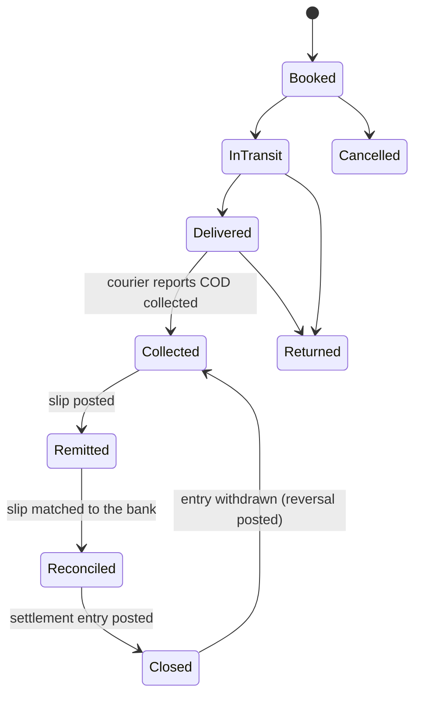

# 12. Prioritized implementation backlog with acceptance criteria

Priorities: **P0** unblocks everything (evidence), **P1** foundation/spine, **P2** operations and intelligence, **P3** structural. The same items are in [REQUIREMENTS_REGISTER.csv](REQUIREMENTS_REGISTER.csv) (template columns; business columns the owner must fill are blank, status `Draft`). Nothing here is approved until the owner accepts it (decision register D-012).

## 1. Backlog

| ID | Pri | Type | Item | Depends on |
| --- | --- | --- | --- | --- |
| `OPS-001` | P0 | Evidence | Run `stage.sh test-combined` on the branch head (reversal + app split + flow) | - |
| `OPS-002` | P0 | Evidence | Run `stage.sh rehearse-upgrade` (copy of staging) | OPS-001 |
| `OPS-003` | P0 | Evidence | Owner-approved `stage.sh upgrade` then `verify` and `smoke` | OPS-002 + named go |
| `OPS-004` | P0 | Evidence | Browser check: apps in the switcher, support button gone after hard refresh | OPS-003 |
| `UAT-001` | P0 | UAT | Owner browser pass of scenarios C1-C17 as each login | OPS-003 |
| `PHA-SEC-001` | P1 | Security | Company scope: decide, then enforce | D-003 |
| `PHA-SEC-002` | P1 | Security | Review exception write surface; add Auditor role and SoD matrix | - |
| `PHA-SEC-003` | P1 | Security | Register every `sudo()`: justification, pre-check, negative test | - |
| `PHA-SEC-004` | P1 | Audit | Audit trail for process mode, courier accounts and authorized deductions | - |
| `PHA-MON-001` | P1 | Data | Money fields to Monetary with currency (non-destructive migration) | D-003 |
| `PHA-CI-001` | P1 | Quality | CI job running pharma Odoo tests and the reserved-name scan (feasibility proven 2026-11-21: `deploy/pharma-staging/local-test.sh tests` runs the suite on a plain Linux box with PostgreSQL; remaining work is the workflow file and the reserved-name scan) | - |
| `PHA-L2C-001` | P1 | Slice | Reference transaction: COD lead-to-cash verified end to end | OPS-003, PHA-FIN-001 |
| `PHA-FIN-001` | P1 | Finance | Localization and period-lock policy (Pakistan chart or documented alternative) | D-006, D-011 |
| `PHA-REC-001` | P1 | Quality | Automate reconciliation checks REC-1..8 | PHA-L2C-001 |
| `PHA-INV-001` | P2 | Inventory | Lots, expiry (FEFO), recall report for pharma stock | D-005 |
| `PHA-P2P-001` | P2 | Slice | Procure-to-pay slice verified (PO, partial receipt, bill, payment) | PHA-FIN-001 |
| `PHA-FIN-002` | P2 | Finance | Bank statement import and automatic matching to remittances | PHA-FIN-001 |
| `PHA-FRT-001` | P2 | Operations | Freight validation against rate cards | D (rate structure) |
| `PHA-RET-001` | P2 | Returns | Returned-parcel COD refund and tax-event reversal | D (policy) |
| `BI-001` | P2 | BI | Metric dictionary and role dashboards with lineage | PHA-REC-001 |
| `AI-001` | P2 | AI | Audit existing AI add-ons against blueprint §12 | - |
| `MUM-TEST-001` | P2 | Quality | Tests for money-moving platform add-ons (billing, e-invoicing, CFO, ZAKI) | - |
| `ARC-001` | P3 | Architecture | Decouple CFO and platform families through an adapter | - |
| `ARC-002` | P2 | Architecture | Integration contracts INT-01..07 on the pack template | - |
| `DOC-001` | P2 | Documentation | Complete the data dictionary's business columns, pharma first | - |
| `DOC-002` | P2 | Documentation | Module specs per module on the pack template | - |

### Acceptance criteria (GIVEN / WHEN / THEN)

- **`OPS-001`**: GIVEN branch head pulled on the VPS WHEN `stage.sh test-combined` runs THEN the result line reads `0 failed, 0 error(s) of N` with N above the previous 189, and the full output is pasted into DEPLOY_LOG
- **`OPS-002`**: GIVEN OPS-001 green WHEN the rehearsal runs THEN verdict is PASSED, five app roots are listed and no leftover shared Pharma root exists; staging database untouched
- **`OPS-003`**: GIVEN a named go WHEN the upgrade runs THEN module versions match the manifests, hardening endpoint is still disabled, courier crons active = 0, smoke reports all apps and menus, counts unchanged, a dump path is printed
- **`OPS-004`**: GIVEN a hard-refreshed browser WHEN logged in as admin THEN five pharma apps with icons show and no vendor support button appears
- **`UAT-001`**: GIVEN each demo login WHEN the presenter script C1-C17 is run THEN every expected result is observed or a defect is logged; sign-off with date
- **`PHA-SEC-001`**: GIVEN two companies in one database WHEN a user of company A requests a company-B parcel, remittance, entry or exception by id through RPC THEN access is refused; OR a signed single-entity decision exists AND a test proves the module refuses a second company
- **`PHA-SEC-002`**: GIVEN an Operations user WHEN they write any exception field other than ownership/notes THEN it is refused; GIVEN an Auditor WHEN they open any pharma record THEN they can read and cannot write, post or approve
- **`PHA-SEC-003`**: GIVEN the 33 `sudo()` call sites WHEN reviewed THEN each has a one-line reason, a permission check on the real user before it, and a test where an unauthorized user is refused
- **`PHA-SEC-004`**: GIVEN a change to `pharma.cod_flow_mode`, a courier account or authorized deductions WHEN saved THEN who/when/old/new is logged and `stage.sh verify` prints the current mode
- **`PHA-MON-001`**: GIVEN existing data WHEN migrated THEN every total is identical before and after, `currency_id` defaults to the company currency, and a mixed-currency entry is refused
- **`PHA-CI-001`**: GIVEN a pull request WHEN CI runs THEN it installs the pharma module list on a throwaway DB and fails the build on any test failure or reserved-attribute shadowing
- **`PHA-FIN-001`**: GIVEN the approved chart and lock policy WHEN an accountant posts into a locked period THEN it is refused; the accountant-signed posting catalog covers every COD event
- **`PHA-REC-001`**: GIVEN seeded and live-like data WHEN the checks run THEN each returns 0 variance, or lists the exact records; a failure fails the test run
- **`PHA-INV-001`**: GIVEN two lots with different expiry WHEN a delivery reserves THEN the earlier-expiring lot is picked; an expired lot cannot be delivered; a recall by lot lists every customer shipment
- **`PHA-P2P-001`**: GIVEN a PO of 10 WHEN 6 are received then billed then paid THEN receipt, bill, payment and GL entries link at line level and reconcile; AP subledger equals the control account
- **`PHA-FIN-002`**: GIVEN a bank file WHEN imported twice THEN the second import adds nothing; a credit with the slip reference matches its remittance; an unmatched credit becomes an exception
- **`PHA-FRT-001`**: GIVEN a courier rate card WHEN a slip deducts freight above the expected amount THEN a finding names the parcel and the excess
- **`PHA-RET-001`**: GIVEN a returned parcel with COD collected WHEN processed THEN a draft refund entry exists, the original tax event is reversed (never edited), and the parcel shows settled
- **`BI-001`**: GIVEN a dashboard tile WHEN clicked THEN it opens the exact records behind the figure; the tile has a dictionary entry (formula, source, owner)
- **`AI-001`**: GIVEN each agent WHEN audited THEN scoped identity, tool allow-list, approval for any write, kill switch and evaluation set are present or logged as gaps
- **`MUM-TEST-001`**: GIVEN each add-on WHEN its suite runs THEN happy, failure, duplicate and permission paths pass; coverage of money paths is reported
- **`ARC-001`**: GIVEN the manifests WHEN analysed THEN no family depends on another in both directions
- **`ARC-002`**: GIVEN each integration WHEN documented THEN identity, idempotency, retry, DLQ and tests are filled; no row says TBD
- **`DOC-001`**: GIVEN the as-built CSV WHEN reviewed THEN company scope, security class, roles, editable states and test id are filled for every pharma field
- **`DOC-002`**: GIVEN a pharma add-on WHEN reviewed THEN it has a signed MODULE_SPEC with requirements and tests

## 2. First vertical slice: `PHA-L2C-001` COD lead-to-cash, verified end to end

**Why this slice:** it is the pharma tenant's reference transaction (blueprint §19 Wave 2), most of it is built, and the one leg never exercised (the collection credit against a real customer invoice) is where a ledger error would hide. It also forces the Gate-0 accounting decisions.

### 2.1 Requirements

| ID | Requirement |
| --- | --- |
| PHA-REQ-L2C-001 | A confirmed sale order for an approved SKU produces a delivery and a customer invoice using native documents; an unapproved SKU is blocked at confirm and at invoice post |
| PHA-REQ-L2C-002 | A delivery report creates one parcel per courier tracking number, linked to its sale order, idempotently |
| PHA-REQ-L2C-003 | `[Proposed, new]` A parcel records the **delivery line(s) and invoice(s)** it settles, so cash can be drilled from parcel to invoice (today there is no such link) |
| PHA-REQ-L2C-004 | The collection entry debits the courier clearing account and credits the customer receivable with the customer on the line; it is created draft, posted by an accountant |
| PHA-REQ-L2C-005 | The posted collection credit is reconciled to the customer invoice; the invoice shows paid by the courier clearing; partial collection leaves the residual open |
| PHA-REQ-L2C-006 | A remittance slip is validated, built, posted and reconciled to the bank; every variance is an exception with an owner |
| PHA-REQ-L2C-007 | The settlement entry credits clearing, debits bank and each deduction, with an explicit difference line; strict order enforced |
| PHA-REQ-L2C-008 | A posted entry is withdrawn by a reversal (draft, reason required, accountant posts) and a corrected entry can follow |
| PHA-REQ-L2C-009 | A posting into a locked period is refused |
| PHA-REQ-L2C-010 | The reconciliation checks REC-1..8 return zero variance |

### 2.2 State diagram

### 2.3 Entities, links and posting

Entities: `sale.order`, `stock.picking`, `account.move` (invoice and entries), `pharma.courier.shipment`, `pharma.courier.remittance` (+ lines, run). Field definitions: see the as-built dictionary. Links: order 1:N parcels; parcel M:N remittance (via lines); parcel 1:0..1 active collection entry; remittance 1:0..1 active settlement entry; **new** parcel M:N invoice line (PHA-REQ-L2C-003).

| Event | Debit | Credit | Reversal |
| --- | --- | --- | --- |
| Invoice posted | Customer receivable | Revenue + tax payable | credit note |
| Collection entry posted | Courier COD clearing | Customer receivable (customer set) | reversal entry |
| Settlement entry posted | Bank; freight; COD fee; withholding income tax; withholding sales tax; other deductions; difference (if short) | Courier COD clearing (gross); difference (if over) | reversal entry |

Account categories are placeholders until an accountant approves the posting catalog (PHA-FIN-001); no statutory treatment is assumed (the withholding lines are receivables or costs as the accountant decides).

### 2.4 Screens and approvals

Screens (exist): Pipeline, Work Queue, Shipments, Remittances, Statement Uploads, Entries to Post, Reverse wizard. New: parcel ↔ invoice drill-down. Approvals: Finance creates drafts, **accountant posts**, Tax Approver approves rules, second controller closes exceptions, written reason for override and reversal.

### 2.5 GIVEN / WHEN / THEN acceptance suite

| ID | Given | When | Then |
| --- | --- | --- | --- |
| L2C-T01 | an order of 10 units, 6 delivered, 4 later | invoicing follows delivered quantity | two invoices, line-level links to both deliveries, totals equal the order |
| L2C-T02 | an SKU with no approved tax rule | the order is confirmed | refused with the SKU named; same at invoice post |
| L2C-T03 | a delivery report with the order reference | the statement is built | one parcel linked to the order; rebuilding adds nothing |
| L2C-T04 | a delivered COD parcel, collected 2,700 of declared 3,000 | the collection entry is created and posted | clearing debited 2,700; invoice residual 300 after reconciliation; a collection exception exists |
| L2C-T05 | a posted collection credit and a posted invoice | the accountant reconciles | invoice payment state reflects the courier clearing; parcel drill-down opens the invoice |
| L2C-T06 | a slip of three parcels with deductions and a bank deposit 400 short | posted, reconciled, settlement created | difference line 400 on the difference account; remittance exception raised; entry balances |
| L2C-T07 | a parcel with no posted collection entry | the settlement entry is created | refused naming the parcel; with a written reason it is created and logged |
| L2C-T08 | a posted settlement entry | Finance requests reversal with a reason | draft reversal exists; the slip still shows the original; after posting, a corrected entry can be created |
| L2C-T09 | a locked accounting period | any COD entry is posted into it | refused by Odoo's lock date |
| L2C-T10 | a user without Finance rights | calls build/reconcile/create-entry by RPC | refused |
| L2C-T11 | two companies `[if D-003 = multi]` | company-A user opens a company-B parcel | refused |
| L2C-T12 | the same delivery file uploaded twice | validate and build twice | second run changes nothing; raw events not duplicated |
| L2C-T13 | the full cycle completed | REC-1..8 run | all variance 0 |
| L2C-T14 | a returned parcel with COD held | processed `[after PHA-RET-001]` | refund draft exists; tax event reversed not edited |

Edge cases to design before build: partial invoice vs partial delivery, courier reports delivered then returned, customer pays the courier less, duplicate parcel tracking across couriers, remittance split across two slips, currency difference (blocked until PHA-MON-001), and cancellation of the order after the parcel is booked.
