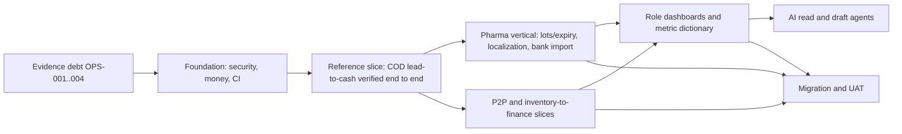

# 10. Development roadmap with milestones and dependencies

Dependency-based, not calendar promises (blueprint §19). Backlog IDs refer to [BACKLOG.md](BACKLOG.md). Gates G0–G8 are the blueprint's; a wave does not start until the previous gate is signed. "Conditional milestone" means *if* its prerequisites hold; no duration is promised.

## 0. Where we are

| Gate | State |
| --- | --- |
| G0 Discovery and current-state audit | **This document set is the draft**; needs owner sign-off of scope and the Gate-0 decisions |
| G1 Architecture and fit-gap | Proposed in `architecture/`; ADRs are *Proposed*; needs approval |
| G2 Foundation (repo conventions, identity, company model, audit, CI) | **Partially met for pharma** (conventions, roles, staging gates); company model, audit view and CI missing |
| G3 Vertical slice | **Evidence debt**: COD slices live and green up to the collection entry (189/189); three later pieces unverified |

## 1. Waves and dependencies

| Wave | Scope | Backlog | Depends on | Exit gate |
| --- | --- | --- | --- | --- |
| **W0 Audit and design** | This document set; charter; ADR approvals; Gate-0 decisions D-001..D-012 | ARC-*, DOC-* | none | G0/G1 signed |
| **W-E Evidence debt** | Run `test-combined` for the reversal + menu split + flow; `rehearse-upgrade`; named-go upgrade; `smoke`; owner browser pass C1–C17 | OPS-001..004, UAT-001 | owner availability | all four PASS with output saved |
| **W1 Foundation** | Company-scope decision and record rules (or signed single-entity decision); Monetary migration plan; CI for pharma Odoo tests; Auditor role; audit trail for config and mode changes; reserved-name/`sudo()` review gate | PHA-SEC-001/002/003, PHA-MON-001, PHA-CI-001 | W-E | G2: security and baseline smoke tests |
| **W2 Financial and commercial spine** | Reference transaction proven end to end *including* collection credit reconciled to a real invoice, reversal, lock dates, trial-balance and AR/clearing reconciliation; localization decision implemented | PHA-L2C-001, PHA-FIN-001, PHA-REC-001 | W1, ADR-005/006/011 | G3 for the reference transaction |
| **W3 Operations** | Lots/expiry/recall; P2P verified; bank statement import; freight validation; returns and refunds tied to tax events | PHA-INV-001, PHA-P2P-001, PHA-FIN-002, PHA-FRT-001, PHA-RET-001 | W2 | G4 per module |
| **W4 Analytics and intelligence** | Metric dictionary, role dashboards over read models; AI recommendation and draft agents under the controls in doc 08 | BI-001, AI-001 | W2/W3 data definitions | dashboards reconcile to source |
| **W5 Migration, UAT, go-live** | Source-to-target maps, dry runs, signed reconciliation, UAT scripts, cutover and rollback rehearsal, monitoring, hypercare | MIG-*, UAT-*, OPS-005.. | W2–W4 | G5–G8 |
| **Parallel track: platform** | Tests for money-moving platform add-ons (billing, e-invoicing, CFO, ZAKI); family-level decoupling adapter; integration contracts | MUM-TEST-001, ARC-001, ARC-002 | none (independent product) | per product |

## 2. Conditional 30 / 60 / 90 milestones

| Horizon | Milestone (conditional on) | Evidence that would close it |
| --- | --- | --- |
| **30** | G0/G1 approved *if* the owner answers the Gate-0 decisions; evidence debt cleared *if* the VPS runs are executed | signed decision register; `test-combined` 0 failed of the new total; `rehearse-upgrade` PASSED; upgrade + smoke output; browser-pass sign-off |
| **60** | Foundation (W1) closed *if* the company-scope decision is made and CI can run Odoo tests; reference-transaction spec approved | CI job green on a pull request; negative cross-company tests (or signed single-entity decision); reconciled AR/clearing figures on a test database |
| **90** | Reference slice verified (W2) *if* a Pakistan localization path is chosen and an accountant approves the posting rules | GIVEN/WHEN/THEN suite for the reference transaction green; accountant-signed posting catalog; period-lock test |

Nothing beyond 90 is committed in this document; W3–W5 are sequenced by dependency and re-planned at each gate.

## 3. Risks that move the plan

| Risk | Effect | Mitigation |
| --- | --- | --- |
| Gate-0 decisions not made (entities, countries, scope) | blocks company model, localization, HR/MFG decisions | decision register with owners; default = pharma stays single-entity, single-currency until signed |
| Third-party accounting kit changes or is withdrawn | Community accounting depth at risk | pinned commit, hardening tests, review at each minor Odoo upgrade (ADR-004) |
| Only staging exists; no production tenant | cannot measure real volumes, performance, data quality | load model and synthetic volume tests before any production claim |
| Evidence cannot be produced from the cloud session (no VPS, no browser) | slices stay "written" | owner-run gates with pasted output, as in the deploy log; CI for Odoo tests to remove the dependency |
| Team capacity across five products in one repo | slow, context-switching | pharma as the reference ERP; platform and jewellery tracked separately |
