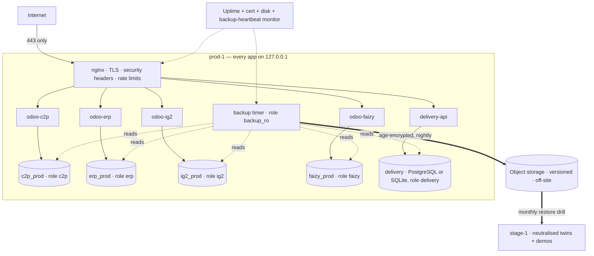

# 11 — Target Architecture

Design goals: clear ownership, production separated from non-production, one database role per application, one repeatable deploy pattern, backups that have been restored at least once, and nothing an on-call person has to remember. **No Kubernetes, no microservices, no new platforms** — the estate is small enough for two well-kept hosts and systemd.

## 1. Principles

1. **One owner per data set.** Each database, filestore and domain has a named business owner and a named technical owner, written down.
2. **A client's data never shares a credential with anyone else's.** Separate PostgreSQL role, separate OS user, separate config file, separate backup key if the contract needs it.
3. **Nothing listens on a public interface except nginx (80/443) and SSH.** Every application binds to `127.0.0.1`.
4. **Production runs tagged releases from `main`.** Never a feature branch.
5. **Everything that runs is in git; everything in git that does not run is archived.**
6. **Staging is a copy of production that cannot talk to the outside world** (neutralised: mail off, crons off, payment keys absent).
7. **A backup counts only after a restore.**
8. **Prefer the pattern already proven here** — the Jewel and Pharma kits — over new tooling.

## 2. Hosts

| Host | Purpose | Notes |
|---|---|---|
| `prod-1` (the current VPS) | Production: nginx, PostgreSQL, production Odoo instances, C2P Agency OS | Sized for production only once staging moves off |
| `stage-1` (new, small VPS) | Staging twins, demo tenants (Jewel, Pharma), restore drills, the WordPress sites if they are kept | Moving non-production off `prod-1` removes the cross-database cron problem by construction and frees memory |
| Object storage (different provider or region) | Encrypted backups, versioned, write-only credential from the hosts | — |
| GitHub | Source, CI, release tags, environment approvals | Private repositories |

A second host is the one structural change proposed. If it is declined (decision D-04), the same isolation is achievable on one host with separate PostgreSQL clusters per trust zone, at the cost of more care.

## 3. Target layout on `prod-1`

### Per-instance standard

| Aspect | Standard |
|---|---|
| Service name | `odoo-<tenant>.service` (`odoo-c2p`, `odoo-erp`, `odoo-ig2`, `odoo-faizy`) — named for the tenant, not numbered |
| OS user | `odoo-<tenant>`, no shell, owns only its own data dir and config |
| Config | `/etc/odoo/<tenant>.conf`, mode 640, group = that user |
| Config contents | `db_name = <one database>`, `dbfilter = ^<that database>$`, `list_db = False`, `http_interface = 127.0.0.1`, `proxy_mode = True`, strong unique `admin_passwd`, explicit `addons_path`, explicit `data_dir`, `workers`, `limit_*`, `max_cron_threads` |
| Database | `<tenant>_prod`, lower case, owned by role `<tenant>` (`NOSUPERUSER NOCREATEDB`) |
| Code | `/opt/odoo/<tenant>/src` checked out at a **tag**; third-party modules in `/opt/odoo/<tenant>/vendor`, pinned by commit and recorded in a `VENDOR.lock` file in the repo |
| Ports | From a registry file in the repo (`infra/PORTS.md`) — one line per instance, HTTP + gevent |
| nginx | `/etc/nginx/sites-available/<hostname>.conf` generated from a template in the repo; includes a shared `snippets/security-headers.conf`; `location ~ ^/web/database { deny all; }`; `client_max_body_size` set; websocket to the instance's own gevent port |
| Logs | `/var/log/odoo/<tenant>.log` with logrotate; journald for the unit |
| Hardening | `NoNewPrivileges=yes`, `ProtectSystem=strict`, `ReadWritePaths=` the data dir and log dir, `PrivateTmp=yes` |

### Network

| Port | Exposure |
|---|---|
| 22 | Key-only, no root login, `fail2ban` or provider firewall allow-list |
| 80, 443 | Public |
| Everything else | Loopback only; default-deny inbound at both `ufw` **and** the Hostinger firewall, so one mistake does not open a port |

### Database server

- One PostgreSQL cluster on `prod-1`, `listen_addresses = localhost`.
- `pg_hba.conf`: each role may connect only to its own database (`local <db> <role> scram-sha-256`); no `all all` lines.
- A `backup_ro` role (member of `pg_read_all_data`) used only by the backup timer.
- No application connects as `postgres` or as a superuser.

## 4. Secrets

| Rule | Mechanism |
|---|---|
| No secret in git, in a unit file, or on a command line | `EnvironmentFile=/etc/<service>/env` (mode 600, owned by the service user) or the `.conf` file with the same permissions |
| One secret, one place | No copying the DB password between configs — each role has its own |
| Inventory | `infra/SECRETS.md` in the repo lists every secret by **name, location, owner and rotation date** — never the value |
| Source of truth | A password manager (1Password/Bitwarden) vault per product; the server files are copies |
| Encryption keys (`C2P_SECRET_KEY`, backup `age` key) | Stored in the vault; the backup private key is **not** on any server |
| Rotation | On staff change, on suspected exposure, and annually; each rotation recorded in `infra/SECRETS.md` |
| CI | GitHub Environment secrets scoped per product; deploy keys restricted with `command=` in `authorized_keys` |

A secrets manager service (Vault, SOPS pipelines) is deliberately not proposed; it would add more operational risk than it removes at this size.

## 5. Environments

| Environment | Where | Data | Outbound |
|---|---|---|---|
| Development | Developer machine or cloud session; Docker Compose from the repo | Seed/demo only | None |
| CI | GitHub Actions; throwaway PostgreSQL service container | None | None |
| Staging | `stage-1`; one twin per production instance | Last night's production backup, neutralised | Mail and payments disabled |
| Demo | `stage-1` (Jewel, Pharma) | Synthetic | None |
| Production | `prod-1` | Real | Real |

Naming: `<product>.<domain>` for production, `<product>.staging.<domain>` for staging, `<product>.demo.<domain>` for demos. Staging and demo hosts send `X-Robots-Tag: noindex` and sit behind an allow-list or basic auth, as Jewel already does.

## 6. Backups (standard — detail in `09_BACKUP_AND_RECOVERY_AUDIT.md` §5)

Nightly per-database dump + matching filestore archive + config bundle → `age`-encrypted → object storage with versioning → heartbeat to the monitor → monthly restore drill on `stage-1`, logged.

## 7. Monitoring and incident handling

One hosted uptime/heartbeat service is enough to start (Uptime Kuma self-hosted on `stage-1`, or a SaaS such as Better Stack / Healthchecks). It holds no customer data.

| Signal | Check | Severity | Notify | First action |
|---|---|---|---|---|
| Site down | HTTPS GET of each product's `/web/health` (Odoo) or `/health` (API) every minute, 3 failures | **P1** | Technical owner by phone push; business owner by email | `systemctl status <unit>`; last deploy log; roll back if within 1 h of a deploy |
| Wrong database served | Synthetic check: `GET /web/login` on each hostname must contain that tenant's expected database marker | **P1** | Technical owner | Take the vhost out; fix mapping |
| Backup missing | Heartbeat not received in 26 h | **P1** | Technical owner + business owner | Run the job by hand; fix; record |
| Certificate expiry | < 14 days | P2 | Technical owner | `certbot renew --dry-run`; fix the vhost |
| Domain expiry | < 30 days | P2 | **Business owner** | Renew at registrar |
| Disk | > 80 % warn, > 90 % P1 | P2 / P1 | Technical owner | Prune old dumps/logs; grow volume |
| Memory / swap, load | sustained > 90 % 10 min | P2 | Technical owner | Identify the instance; check workers |
| PostgreSQL | connections > 80 % of max; replication n/a | P2 | Technical owner | Find idle-in-transaction sessions |
| Application errors | Odoo log `ERROR`/`CRITICAL` rate; API 5xx rate from nginx | P3 (P2 if sustained) | Technical owner, daily digest | Triage |
| Failed scheduled jobs | Odoo `ir.cron` with failures; systemd timer `failed` state | P2 | Technical owner | Re-run; fix |
| Authentication anomalies | nginx: > N 401/403 per IP per minute on `/web/login`, `/auth/*`; `fail2ban` bans | P3 | Daily digest | Review; tighten rate limit |
| Payment / integration failures | Stripe webhook 4xx/5xx; e-invoicing gateway rejections | P2 | Business owner + technical owner | Check provider status; replay |

Severity definitions: **P1** — customer-facing outage or data-protection failure; respond within 30 minutes, any hour. **P2** — degraded or will become P1; same business day. **P3** — hygiene; weekly review.

Every P1 gets a short written record: timeline, cause, what was changed, what will prevent it.

## 8. What stays the same

- Odoo 19 Community, native packages, systemd, nginx, certbot — all already in use and well understood here.
- The Jewel compose stack as-is (it is correctly isolated), relocated to `stage-1` when that exists.
- Faizy's instance layout — it already follows most of this standard and is the template for the others.
- `c2p-delivery-system/deploy/update.sh` as the deploy entry point, extended with a pre-deploy copy of the SQLite store.
