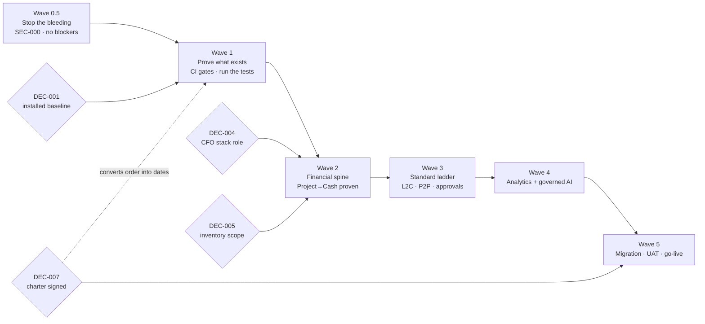

# Deliverable 10 — Development roadmap with milestones and dependencies

Blueprint §19: waves are **dependency-based, not calendar promises**. There are no
dates in this document and there will not be until `PROJECT_CHARTER.md` is signed
(DEC-007). Each wave has an entry gate, an exit gate and an explicit blocker list.

---

## Wave 0 — Audit and design · **COMPLETE (this change)**

| Exit gate | Status |
|---|---|
| Platform determined from evidence | ✅ Odoo 19 Community |
| AS-IS capability inventory | ✅ `02-CAPABILITY-MATRIX.md` |
| Architecture and data-integrity report | ✅ `MODULE_DEPENDENCY_MAP.md`, `ENTITY_RELATIONSHIPS.md` |
| Fit-gap analysis | ✅ `FIT_GAP_REGISTER.md` |
| Security framework | ✅ `SECURITY_MATRIX.md` |
| Dependency-aware TO-BE roadmap | ✅ this document |
| Decision register | ✅ `DECISION_REGISTER.md` — 8 open |
| Charter | ⚠️ **DRAFT** — 12 fields to confirm |

**Wave 0 does not exit cleanly.** The charter is unsigned and eight decisions are
open, two of which (DEC-001, DEC-004) block Wave 2 outright.

---

## Wave 0.5 — Stop the bleeding · **NO DEPENDENCIES, START NOW**

Everything here is independent of every open decision. Nothing below needs
approval, design, or a charter.

| ID | Item | Why it cannot wait |
|---|---|---|
| `SEC-000` | Close the production exposure: firewall the Odoo application ports, replace the default-strength admin credential on the live business database | An internet-reachable ERP with a guessable admin password. Every other control in this plan is theatre until this is done |
| `SEC-001` | Rename one of the two groups named "Super Admin" | An administrator cannot currently tell which grants what, and credential field access depends on picking the right one |
| `MON-001` | Certificate-expiry and uptime monitoring for all hosted domains | A certificate renewal has already been observed out of step with the others; a silent renewal failure becomes a client-visible outage |
| `OPS-001` | Resolve the production add-on layout: one checkout on the `addons_path`, locate or remove the source-less installed module | Until this is done, `addons/` in git is not demonstrably what production runs |

**Exit gate:** ports closed, credential rotated, one checkout, monitoring alerting.

---

## Wave 1 — Prove what exists · **Entry: Wave 0.5 complete + DEC-001 answered**

The theme is **evidence, not features**. 21,772 lines of code exist and nothing
has been demonstrated to work. Blueprint §21.2 forbids claiming otherwise.

| ID | Item | Depends on |
|---|---|---|
| `DEC-001` | Installed-module baseline for all five instances, committed | — (must be run on the VPS) |
| `CI-001` | Promote `faizy-ci.yml`'s checks to the whole repository | DEC-001 |
| `CI-002` | Add the module-install gate: `-i <module> --test-enable --stop-after-init` per module on a throwaway DB | CI-001 |
| `CI-003` | Add syntax-hygiene, ACL-coverage, money-typing and cycle gates (`scripts/audit/*`) | CI-001 |
| `PRJ-002` | Install `c2p_project_tracker` on a restored copy per its own runbook; **run the 57 tests**; render both dashboards and both PDFs | DEC-001, CI-002 |
| `TEST-001` | First tests for `mumtaz_core` and `mumtaz_tenant_manager` — the two most-depended-upon modules, currently untested | CI-002 |
| `DOC-001` | Fill the four governance columns in `DATA_DICTIONARY_AS_IS.csv` | data-governance workshop |

**Exit gate:** every module installs in CI; the 57 existing tests pass (or their
failures are recorded and fixed); `PRJ-002` produces real rendered artefacts. At
this point the word "working" becomes usable for the first time.

**This wave writes almost no application code.** That is the point.

---

## Wave 2 — The financial and commercial spine · **Entry: Wave 1 exit + DEC-004 + DEC-005**

Blueprint §19 Wave 2: choose one reference transaction and prove the entire flow.

### Reference transaction: **Project → Cash**

Chosen over quote-to-cash deliberately. `PROCESS_LINKAGE_MATRIX.md` §5 shows it
is the only process where the custom work is already done — the delivery-control
half is built and tested-but-unrun. The missing half is one link to the ledger.
Quote-to-cash would mean starting from nothing.

| ID | Item | Depends on |
|---|---|---|
| `ARCH-001` | The §7.1 entity mixin: `source_system`, `source_record_id`, `version`, `approval_state`, `approved_by`, `approved_at`, `correlation_id` | — |
| `PRJ-001` | Install and configure standard `hr_timesheet`; wire to `project` | DEC-005 scope |
| `FIN-001` | Write the posting catalogue (blueprint §20.1 item 5) for every money event in scope | DEC-004 |
| `FIN-002` | Make `project.project.amount_received` computed from reconciled payments on invoices linked to `c2p_sale_order_id`; keep the hand-entered value only as a visibly flagged override | FIN-001, PRJ-002 |
| `FIN-003` | Replace `consultants_margin` with a true margin: revenue − subcontract − **labour** (now available from timesheets) | PRJ-001, FIN-002 |
| `FIN-004` | Fix `mumtaz.module.bundle.monthly_price` from `Float` to `Monetary` | — |
| `SEC-005` | `groups=` on `mumtaz_media_buying`'s cost, commission and margin fields | — |
| `INT-001` | Idempotency: one mixin + unique index on `(source_system, source_record_id)`; apply to the Stripe webhook and e-invoice submission paths | ARCH-001 |
| `BI-001` | `MetricDefinition` model — the semantic KPI layer with lineage | FIN-001 |

**Exit gate — the project's real milestone.** A user opens a portfolio project and
drills from `amount_received` through the invoices and reconciled payments to the
journal entries, and the figure agrees with the trial balance. Blueprint §22's
worked example, applied to this business.

**Deliberately not in Wave 2:** quote-to-cash and procure-to-pay. They are
standard Odoo; they need configuration and testing, not development, and they
follow once the pattern above is proven once.

---

## Wave 3 — Operations and the standard ladder · **Entry: Wave 2 exit**

Six of the ten biggest gaps close with standard Odoo or configuration
(`FIT_GAP_REGISTER.md` §6). This wave is mostly installing and configuring.

| ID | Item | Rung |
|---|---|---|
| `L2C-001` | Configure and test quote → order → delivery → invoice → payment, with the §6.1 variants (partial delivery, down payment, split invoice, credit note, multi-currency) | **Standard** |
| `P2P-001` | Configure 3-way match via Odoo's purchase bill-control policy; `account_budget` for budget checks | **Standard** |
| `APR-001` | Approval workflow via Automation Rules + activities; code only if those fail | **Configure** |
| `AR-001` | AR ageing and follow-up levels | **Standard** |
| `ARCH-002` | Invert `mumtaz_portal_routing → mumtaz_cfo_base` (layering violation) | Refactor |
| `ARCH-004` | Consolidate the eight scaffolding modules into `mumtaz_core` + `mumtaz_ui` | DEC-001 |
| `ARCH-003` | Migrate `media.plan` onto `sale.order` + pricelists; keep `media.outlet`/`media.rate.card` | **Needs approval** — may hold live data |
| `UX-001` | RTL audit; logical properties in all custom CSS | — |

---

## Wave 4 — Analytics and governed AI · **Entry: Wave 3 exit + BI-001**

| ID | Item |
|---|---|
| `BI-002` | CFO dashboard on the metric layer, every tile drillable |
| `BI-003` | CEO/Group dashboard, stating explicitly whether eliminations are applied |
| `SEC-002` | Classify every AI agent action: read-only / recommend / draft / act-with-approval, as an enum on the agent model |
| `SEC-003` | A named service user per agent with minimum groups — never `base.group_system`, never a human's session |
| `SEC-004` | Global AI kill switch on `mumtaz.core.settings`, checked before every outbound call |
| `AI-002` | Evaluation corpus and spend limits per agent |
| `DEC-003` | Decide and enforce the Agency OS's write scope against client production |

**Gate:** no AI action may touch `account` without passing `SEC-002`–`SEC-004`.
Today `mumtaz_ai` references `account` with none of them in place; that is the
single riskiest design in the repository and this wave is where it closes.

---

## Wave 5 — Migration, UAT, go-live · **Entry: Wave 4 exit + full charter**

| ID | Item |
|---|---|
| `MIG-001` | Source audit of the 41,182-lead CRM dataset; decide retain / archive / discard |
| `MIG-002` | Apply the CRM findings in `c2p-delivery-system/docs/07-mumtaz-c2p-crm-findings.md` (written, deliberately not applied) |
| `MIG-003` | External-identity mapping, idempotent upserts, reconciliation register |
| `MIG-004` | Dry run with rollback rehearsal, then reconcile counts **and** values |
| `UAT-001` | Business-user scripts per role with signed evidence |
| `GO-001` | Go/no-go with hypercare plan |

---

## Dependency graph

## Regression obligation

Blueprint §19: every wave re-runs all earlier waves' tests, role tests and
migration checks, and ends with a go/no-go. No wave is closed on a demo.

## What this roadmap refuses to do

- **No percentage-complete claims.** Blueprint §19 and §23 prohibit them.
- **No dates before the charter.** A schedule built on twelve unknowns is a guess
  with a deadline attached.
- **No new feature module before Wave 2's exit gate.** Twelve capabilities are
  already "Partial" for one shared reason — code written without tests, record
  rules or a posting map. Adding a thirteenth makes the problem worse, not the
  product better.
