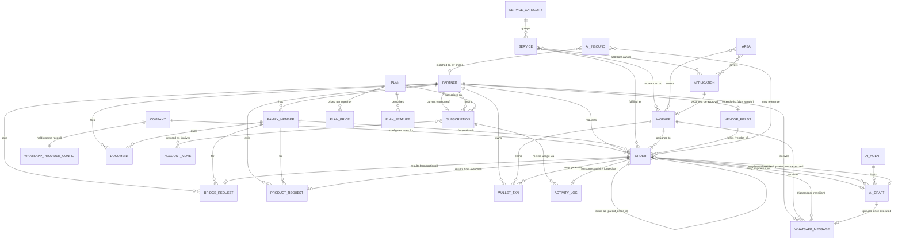

# Faizy — Entity Relationship Reference

The real schema: every model that exists in `faizy_core`, `faizy_website` and `faizy_ai` today (22
models total, confirmed by `odoo/tools/validate_modules.py`), not an illustrative generic ERP
shape. `res.partner`, `res.company` and `account.move` are native Odoo models, extended rather than
duplicated.

## Field-level notes that matter more than the diagram shapes

- **`faizy.order` is the hub of the whole system.** Every other transactional model either produces
  an order (`bridge.request`, `product.request`, recurring template via `parent_order_id`) or reacts
  to one (`whatsapp.message`, `ai.draft`, `activity.log`, `wallet.transaction`). There is no
  generic "transaction" superclass — `faizy.order` plays the role a blueprint-style ERP would split
  across `SalesOrder` + `ServiceOrder` + `WorkOrder`.
- **`faizy.subscription` → `account.move` is a plain `Many2many`, not a line-level allocation
  table.** The blueprint's generic model (§7.3) calls for `Invoice <-> Payment` via settlement
  allocations with residual/FX tracking; Faizy relies entirely on native `account.move` payment-state
  tracking instead of a Faizy-specific allocation model. That is a reasonable simplification given
  there is exactly one invoice per billing period, not a many-to-many billing scenario.
- **`faizy.wallet.transaction` has no relationship to `account.move` at all.** It is a parallel,
  informational ledger (`txn_type`, `amount`, `partner_id`/`worker_id`), not a subledger that
  reconciles to anything. Treat its balance as directional information for the customer-facing UI,
  not as an accounting fact — this is already implicit in the code (no journal posting anywhere
  near it) but is easy to misread from the model name alone, hence calling it out here.
- **`faizy.ai.draft.order_id` and `result_order_id` are deliberately different fields** — the first
  is the order a draft is *about* (for `order_update`), the second is the order a draft *created*
  (for `order_create`). Collapsing them into one field would make an executed `order_create` draft
  indistinguishable from an `order_update` draft about a pre-existing order.
- **No field anywhere stores a currency-converted total across currencies.** `faizy.plan.price` is
  one row per currency (no FX computation); `faizy.order.currency_id` defaults to
  `env.company.currency_id` and never converts. This matches ADR-006/PLT-05's narrow scope (multi
  *market pricing*, not multi-currency accounting) — correct for "publish a real local price per
  market" but would not survive a requirement to report consolidated revenue across currencies
  without a conversion step that does not exist today.

## Referential rules actually enforced in code (not aspirational)

- `faizy.order._check_vendor_approved`: a `vendor_id` must be an active, approved Faizy vendor —
  enforced as a model constraint, not just a UI domain (the code comment explains exactly why: "a
  domain is advisory... it does nothing against an import, an automation or a write from code").
- `faizy.ai.draft._check_content`: blocks stale WhatsApp numbers and disallowed order actions from
  ever reaching a queued message — a real server-side guard, not a UI validation.
- `faizy.ai.draft.write`: a non-approver can only edit `AI_DRAFT_FIELDS` on their own still-`draft`
  rows — enforced in `write()`, so it holds against direct ORM calls too, not only the form view.
- No `ondelete='cascade'` was found on any fiscally-relevant relationship in `faizy_order.py` or
  `faizy_subscription.py` (child orders use `ondelete="set null"` on `parent_order_id`) — consistent
  with the blueprint's "never cascade-delete posted fiscal or inventory history" invariant, though
  this project has no posted-history concept to begin with (ADR-011).
