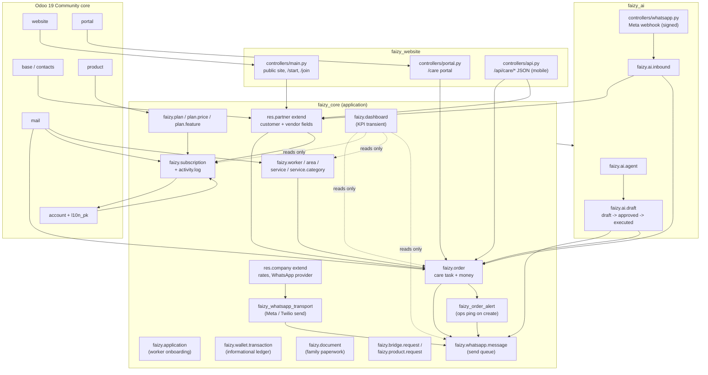

# Faizy — Module Dependency Map

Actual dependency graph of the three installed addons and their key cross-module data flows, not a
conceptual wishlist. Compare against `faizy/docs/project/FIT_GAP_REGISTER.md` for what each box is
and is not.

## What this diagram shows that the generic blueprint map doesn't

- **No CRM, purchasing, inventory, or manufacturing boxes exist** — correctly, per the fit-gap
  register. `faizy.order` carries both the "sales" and "service delivery" role in one model; there
  is no separate quotation step.
- **Two parallel WhatsApp send paths exist on `faizy.order`'s side:** the order's own
  `_notify_whatsapp` (customer-facing, unconditional, no approval) and `faizy_ai`'s draft pipeline
  (any kind, always approval-gated). Both end up in the same `faizy.whatsapp.message` queue, drained
  by one cron. They are not in conflict, but they are two different governance philosophies for
  adjacent problems — noted in `00-decisions.md` and `DECISION_REGISTER.md` ADR-007, not resolved
  here.
- **`faizy_website`'s `api.py` (the mobile JSON API) depends only on `faizy_core`'s models, through
  the inherited `_create_care_request`/`_needs_plan` helpers from `portal.py`** — it does not
  duplicate booking rules. This is the one place in the codebase that explicitly protects against
  rule drift between two front doors (web portal vs. app) into the same booking logic.
- **`faizy.dashboard` is read-only** by construction (`TransientModel`, no write methods) — it cannot
  be a second source of truth for anything, which matches the blueprint's "one authoritative owner
  per business fact" invariant (§4.2) without anyone having to enforce it by convention.

## Dependency anti-patterns checked against this codebase

- AI does not own or post the ledger: confirmed — `faizy_ai.draft._execute_order_update` only calls
  existing `faizy.order` actions (`action_confirm`/`action_assign`/`action_start`), never writes
  `account.move` directly.
- No two-way technical dependency between `faizy_core` and `faizy_ai`: confirmed — `faizy_ai`
  depends on `faizy_core`, never the reverse. `faizy_order_alert.py` (in `faizy_core`) and
  `faizy_ai`'s draft system are parallel, not mutually dependent.
- Sales and procurement share one catalog: trivially true — there is no separate procurement module
  to diverge from `faizy.service`.
